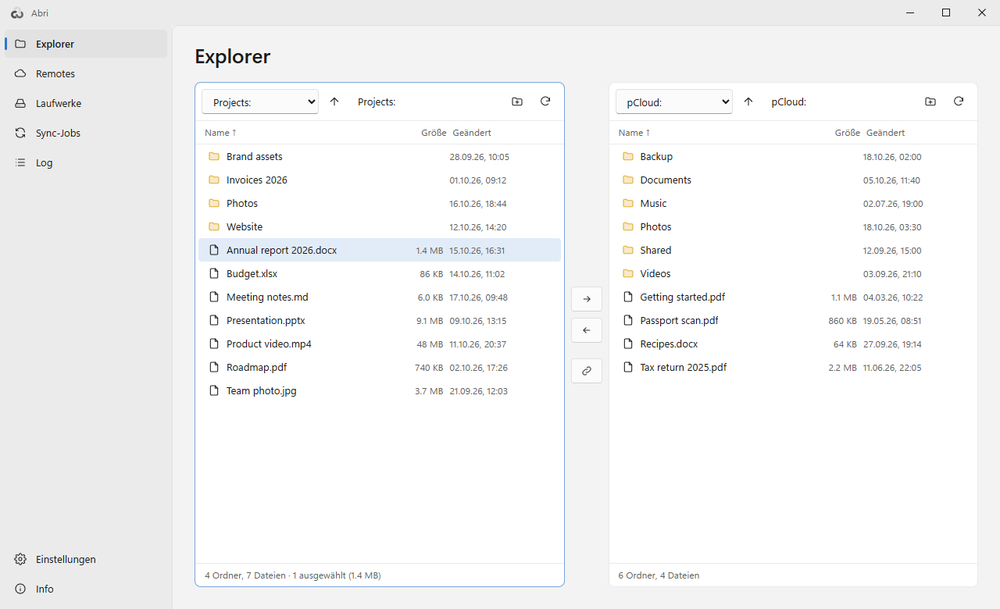
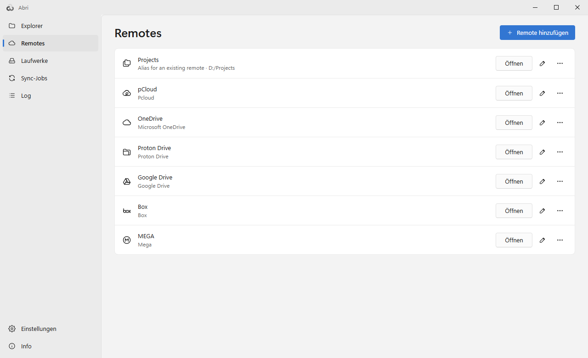
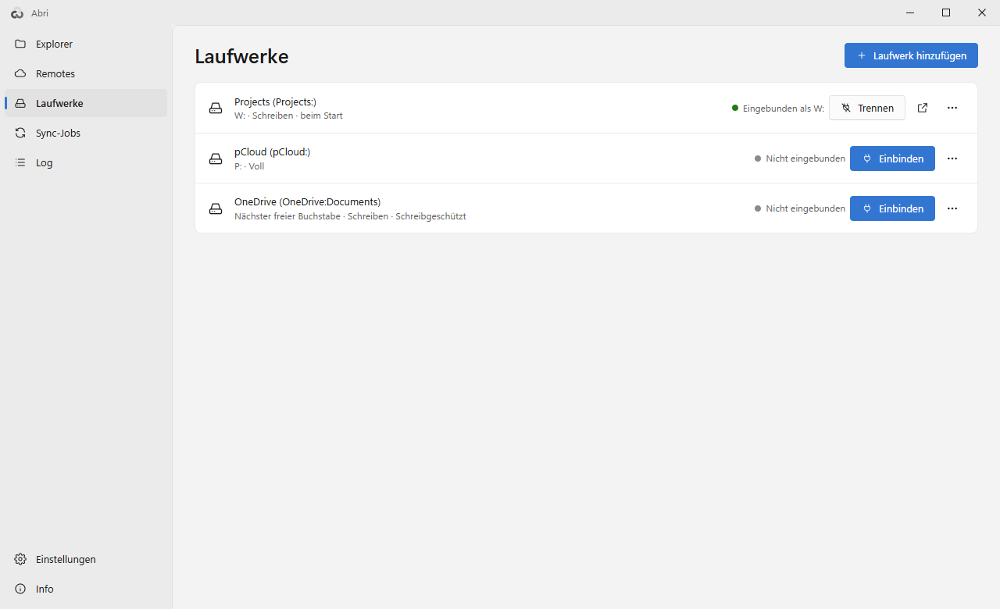
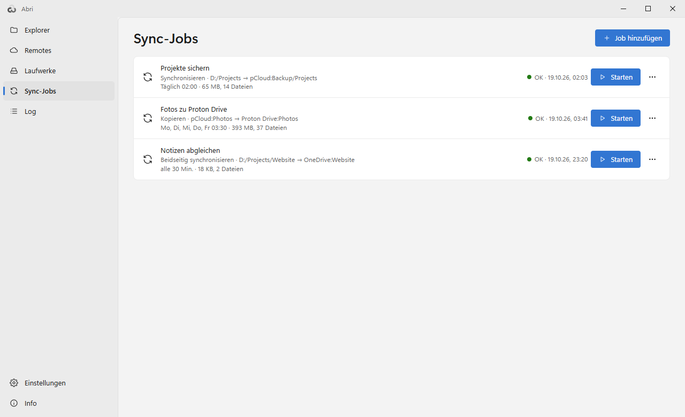
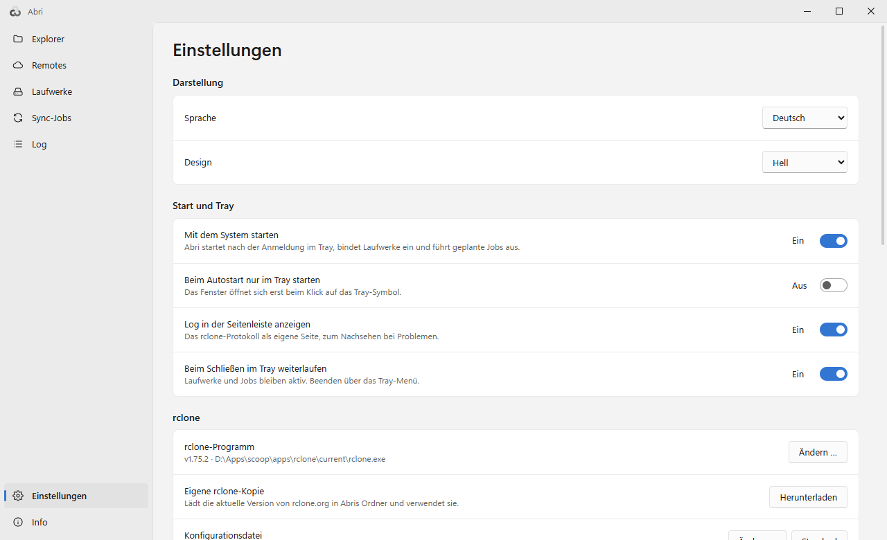
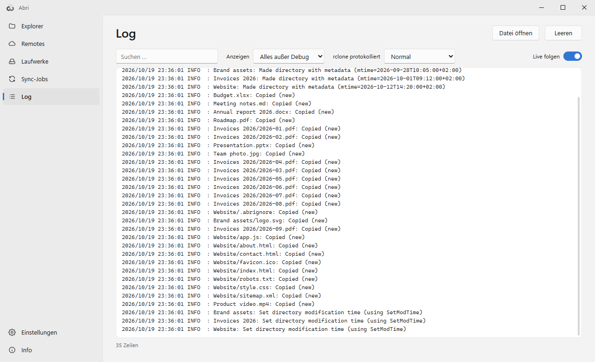
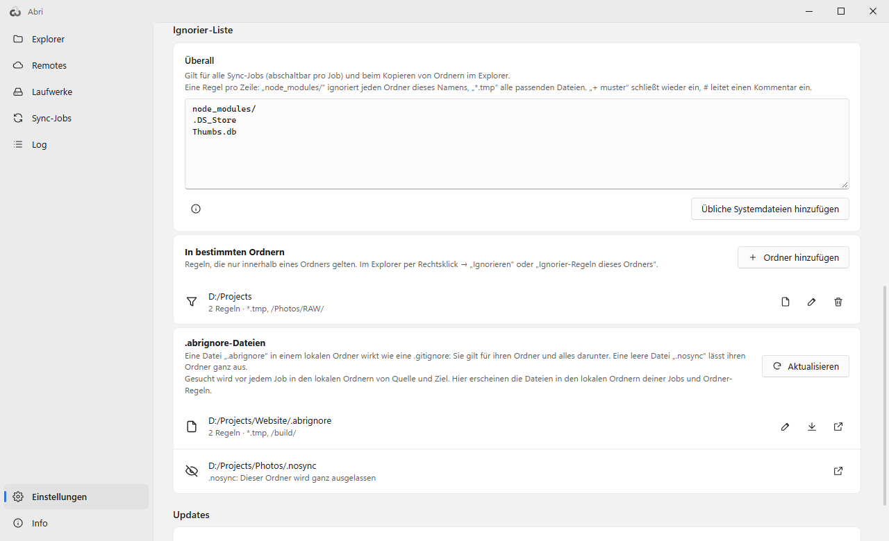

# Abri

[English](README.md) | **Deutsch**

Eine freundliche Oberfläche für [rclone](https://rclone.org), die im Tray lebt: Cloud-Speicher durchsuchen, als Laufwerk einbinden und Ordner nach Zeitplan synchron halten.

*Abri* (ابری) ist Persisch und heißt „wolkig“.

<picture>
  <source media="(prefers-color-scheme: dark)" srcset="docs/explorer-dark.de.png">
  
</picture>

- **Explorer** mit zwei Seiten: pCloud, OneDrive, Google Drive, Dropbox, Box, Proton Drive, MEGA, S3, SFTP und jeder andere Dienst, den rclone kennt – nebeneinander und neben den Ordnern auf deinem Rechner
- **Laufwerke:** jedes Remote als Laufwerksbuchstabe, mit schnellen Cache-Vorgaben
- **Sync-Jobs:** synchronisieren, kopieren, verschieben oder beidseitig synchronisieren – manuell, in festen Abständen oder zu einer Uhrzeit, auch wenn Abri nur im Tray läuft
- **Ignorier-Listen:** eine globale Liste (Vorgabe `node_modules/`), Regeln für einzelne Ordner und **`.abrignore`-Dateien – geschrieben wie eine `.gitignore` –, die mit deinen Ordnern mitwandern**; eine leere `.nosync`-Datei überspringt ihren Ordner ganz
- Nutzt **dein vorhandenes rclone und seine `rclone.conf`** – nichts wird umgewandelt; ohne rclone lädt Abri die aktuelle Version von rclone.org
- Remotes direkt in Abri einrichten, inklusive Anmeldung im Browser bei OAuth-Diensten
- Deutsche und englische Oberfläche (folgt der Windows-Sprache), helles und dunkles Design
- Portabel: eine einzige EXE, Einstellungen in `abri.json` daneben

## Download

- **[Neueste Version](https://github.com/naderi/abri/releases/latest)** – entweder `Abri.exe` (portabel: in einen beliebigen Ordner legen und starten) oder `Abri_<version>_x64-setup.exe` (Installer für den aktuellen Benutzer, ohne Administratorrechte).
- Oder mit [Scoop](https://scoop.sh):

  ```
  scoop bucket add naderi https://github.com/naderi/scoop-bucket
  scoop install naderi/abri
  ```

Voraussetzungen: Windows 10/11 (64 Bit). Für Laufwerke wird zusätzlich [WinFsp](https://winfsp.dev/rel/) benötigt – fehlt es, zeigt Abri einen Download-Link.

## Die Seiten

### Explorer

Zwei Seiten, jede zeigt ein Remote oder einen Ordner auf *Dieser Rechner*. Die Auswahl auf die andere Seite kopieren (F5) oder verschieben (F6); der Fortschritt erscheint im Streifen unter den Seiten. Rechtsklick für *Umbenennen (F2)*, *Neuer Ordner*, *Löschen*, die Größe eines Ordners oder *Öffentlichen Link kopieren*. *Synchron blättern* lässt beide Seiten gemeinsam in gleichnamige Ordner wechseln.

### Remotes

<picture>
  <source media="(prefers-color-scheme: dark)" srcset="docs/remotes-dark.de.png">
  
</picture>

Alle Remotes deiner `rclone.conf`, jedes mit dem Symbol seines Dienstes. *Remote hinzufügen* führt durch jeden Dienst, den rclone unterstützt. Im ⋯-Menü: *Speicherplatz*, *Neu anmelden*, *Nach oben* / *Nach unten* und *Alphabetisch sortieren* – die Reihenfolge steht in Abris Einstellungen, deine `rclone.conf` bleibt unangetastet.

### Laufwerke

<picture>
  <source media="(prefers-color-scheme: dark)" srcset="docs/mounts-dark.de.png">
  
</picture>

Ein Remote (oder einen Ordner darin) als Laufwerksbuchstabe oder Ordner einbinden, wahlweise *Schreibgeschützt*, *Als Netzlaufwerk* und *Beim Start von Abri einbinden*. Abri behält gelesene Dateien 24 Stunden im Cache (bis 5 GB). Dienste wie pCloud, OneDrive, Google Drive oder Dropbox melden Änderungen selbst, deshalb darf *Ordnerinhalte neu lesen nach* lang sein – das macht das Laufwerk deutlich schneller. Das schnellste Laufwerk gibt es mit Cache *Voll*.

### Sync-Jobs

<picture>
  <source media="(prefers-color-scheme: dark)" srcset="docs/jobs-dark.de.png">
  
</picture>

*Synchronisieren*, *Kopieren*, *Verschieben* oder *Beidseitig synchronisieren* (rclone bisync) zwischen zwei beliebigen Orten, *Nur manuell*, *In festen Abständen* oder *Zu einer Uhrzeit* an ausgewählten Wochentagen. Optionen: *Probelauf (nichts ändern)*, *Prüfsummen vergleichen*, *Bandbreite begrenzen* und eine Ignorier-Liste nur für diesen Job. Über das Tray-Menü lässt sich jeder Job sofort starten.

### Einstellungen

<picture>
  <source media="(prefers-color-scheme: dark)" srcset="docs/settings-dark.de.png">
  
</picture>

Sprache und Design, *Mit dem System starten* (Abri bindet dann Laufwerke ein und führt geplante Jobs aus dem Tray aus), *Beim Schließen im Tray weiterlaufen*, rclone-Programm und Konfigurationsdatei, die Ignorier-Listen und Updates.

### Log

<picture>
  <source media="(prefers-color-scheme: dark)" srcset="docs/log-dark.de.png">
  
</picture>

rclones Log mit Suche, Filter nach Stufe und Live-Verfolgung – einzuschalten in den Einstellungen mit *Log in der Seitenleiste anzeigen*.

## Ignorier-Regeln und `.abrignore`-Dateien

<picture>
  <source media="(prefers-color-scheme: dark)" srcset="docs/settings-ignore-dark.de.png">
  
</picture>

Was nie synchronisiert werden soll, wird an drei Stellen festgelegt und gilt für alle Sync-Jobs und für Ordnerkopien im Explorer:

1. **Überall** – die globale Liste in den Einstellungen (Vorgabe `node_modules/`).
2. **In bestimmten Ordnern** – Rechtsklick im Explorer → *Ignorieren* oder *Ignorier-Regeln dieses Ordners …*.
3. **`.abrignore`-Dateien** – eine `.abrignore` in einem lokalen Ordner funktioniert wie eine `.gitignore` und gilt für ihren Ordner und alles darunter: `*.log` und `build/` in jeder Tiefe, `/dist/` nur hier, `!keep.log` nimmt wieder auf, die letzte passende Zeile gewinnt. **Die Regeln liegen beim Ordner**, sie werden also mit ihm verschoben, gesichert und weitergegeben. Eine leere **`.nosync`**-Datei überspringt ihren Ordner ganz.

Die Einstellungen listen jede `.abrignore` in den Ordnern deiner Jobs auf. Ordnerregeln werden mit *In .abrignore verschieben* zur Datei, eine Datei mit *In Einstellungen übernehmen* wieder zu Ordnerregeln – ignoriert wird dabei genau dasselbe. Ignorierte Einträge erscheinen im Explorer abgeblendet.

## Programm-Updates

Abri aktualisiert sich selbst aus den [Releases dieses Repositorys](https://github.com/naderi/abri/releases):

- Einmal am Tag sucht es im Hintergrund nach einer neuen Version (abschaltbar: *Automatisch suchen (einmal täglich)*). Eine neue Version zeigt einen orangen Punkt auf dem *Info*-Button.
- Im Info-Fenster: *Nach Updates suchen* → *Update herunterladen* → *Neu starten & aktualisieren* (bei installierten Kopien: *Installer starten*).
- Ein Download wird nur verwendet, wenn seine Signatur (`.sig`) zum in Abri eingebauten Schlüssel passt; alles andere wird abgelehnt. `abri.json` bleibt unangetastet.
- Mit Scoop installiert, verweist Abri nur auf `scoop update abri`.

## Lizenz

Freeware – kostenlos nutzbar, aber **nicht verkäuflich**. Siehe [LICENSE](LICENSE).

Abri ist kein offizielles rclone-Projekt. rclone ist © Nick Craig-Wood und Mitwirkende (MIT-Lizenz); Abri enthält es nicht, sondern nutzt das auf deinem Rechner installierte rclone oder lädt es von rclone.org. Das App-Symbol basiert auf dem rclone-Logo (MIT-Lizenz); einige Dienst-Symbole basieren auf [Tabler Icons](https://tabler.io/icons) (MIT-Lizenz).

© 2026 [Ali Naderi](https://github.com/naderi) · [digitalent.dev](https://digitalent.dev/de/)
