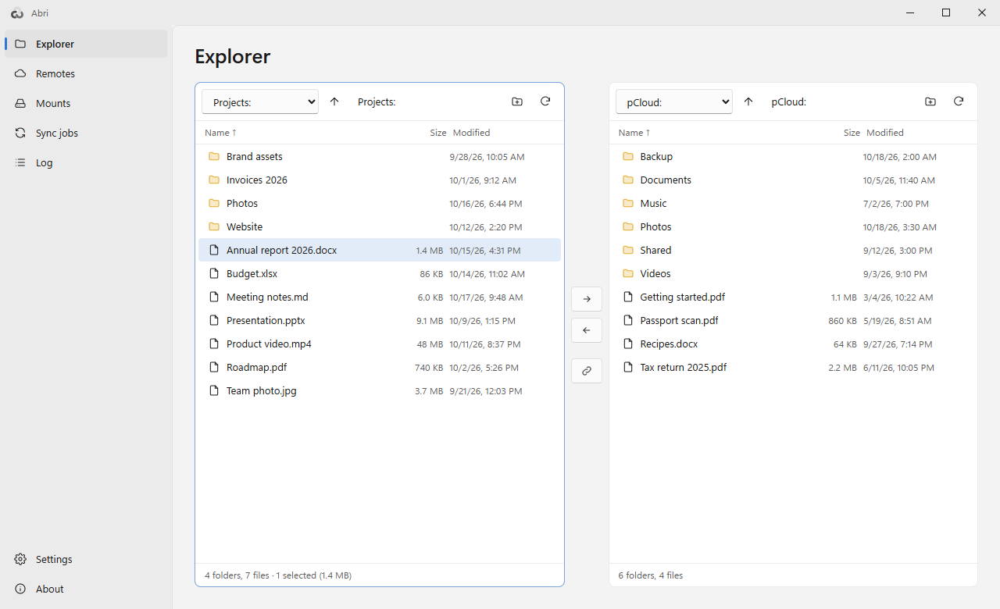
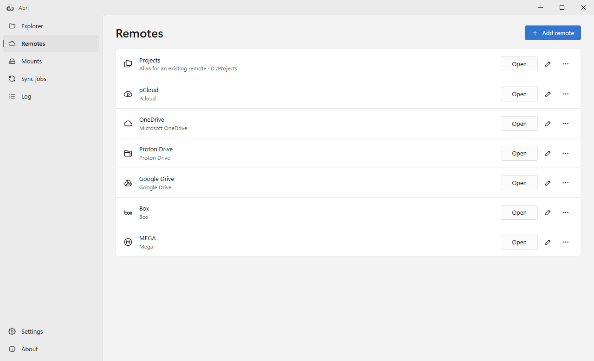
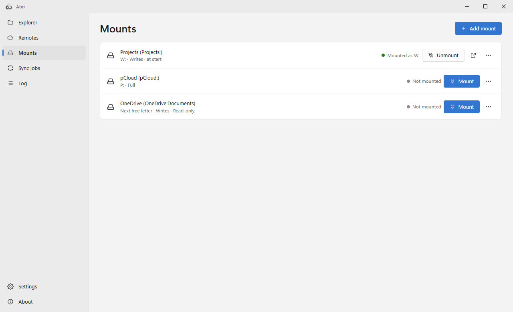
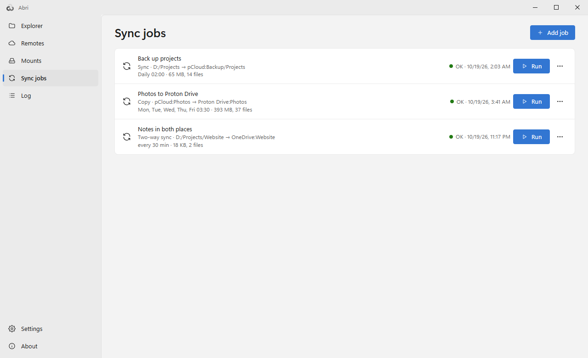
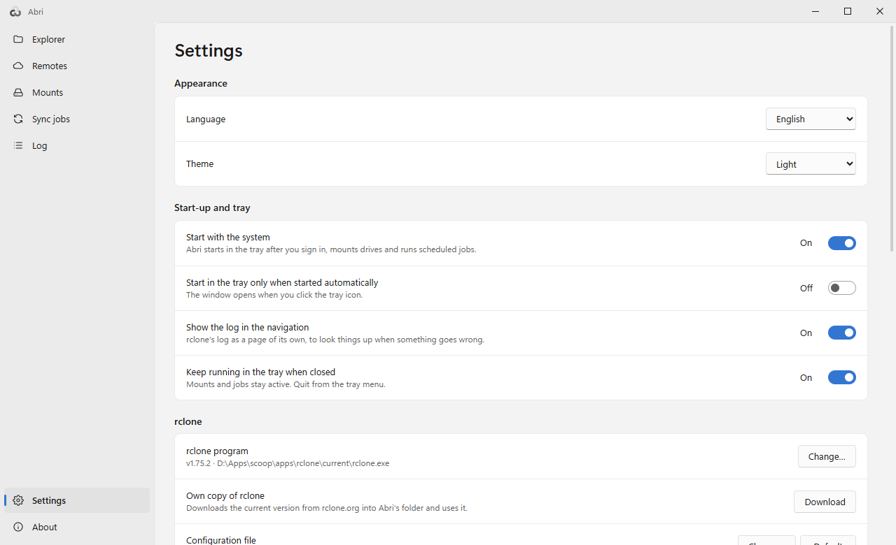
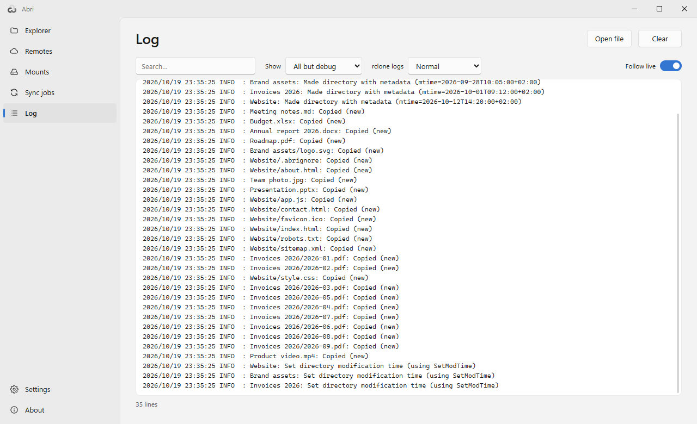
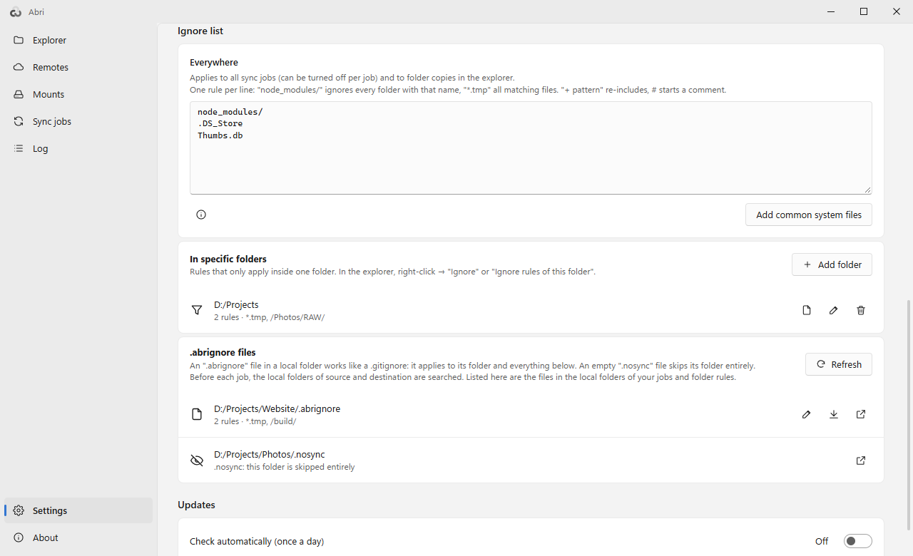

# Abri

**English** | [Deutsch](README.de.md)

A friendly desktop front end for [rclone](https://rclone.org) that lives in the tray: browse your cloud storage, mount it as drives and keep folders in sync on a schedule.

*Abri* (ابری) is Persian for "cloudy".

<picture>
  <source media="(prefers-color-scheme: dark)" srcset="docs/explorer-dark.png">
  
</picture>

- **Explorer** with two panes: pCloud, OneDrive, Google Drive, Dropbox, Box, Proton Drive, MEGA, S3, SFTP and every other service rclone supports – side by side and next to the folders on your computer
- **Mounts:** any remote as a drive letter, with fast cache defaults
- **Sync jobs:** sync, copy, move or two-way sync, manually, at intervals or at a time of day – also while Abri is only in the tray
- **Ignore lists:** a global list (default `node_modules/`), rules for single folders, and **`.abrignore` files – written like a `.gitignore` – that travel with your folders**; an empty `.nosync` file skips its folder entirely
- Uses **your existing rclone and its `rclone.conf`** – nothing is converted; without rclone, Abri downloads the current version from rclone.org
- Set up remotes in Abri, including sign-in in the browser for OAuth services
- English and German UI (follows the Windows language), light and dark theme
- Portable: a single EXE, settings in `abri.json` next to it

## Download

- **[Latest release](https://github.com/naderi/abri/releases/latest)** – either `Abri.exe` (portable: put it into a folder of your choice and run it) or `Abri_<version>_x64-setup.exe` (installer for the current user, no admin rights needed).
- Or with [Scoop](https://scoop.sh):

  ```
  scoop bucket add naderi https://github.com/naderi/scoop-bucket
  scoop install naderi/abri
  ```

Requirements: Windows 10/11 (64-bit). Mounting drives also needs [WinFsp](https://winfsp.dev/rel/) – Abri shows a download link if it is missing.

## The pages

### Explorer

Two panes, each showing a remote or a folder on *This computer*. Copy (F5) or move (F6) the selection to the other side; progress shows in the strip under the panes. Right-click for *Rename (F2)*, *New folder*, *Delete*, the size of a folder or *Copy public link*. *Synchronous browsing* moves both sides into folders of the same name together.

### Remotes

<picture>
  <source media="(prefers-color-scheme: dark)" srcset="docs/remotes-dark.png">
  
</picture>

All remotes of your `rclone.conf`, each with the icon of its service. *Add remote* walks you through any service rclone supports. In the ⋯ menu: *Storage space*, *Sign in again*, *Move up* / *Move down* and *Sort alphabetically* – the order is kept in Abri's settings, your `rclone.conf` is not touched.

### Mounts

<picture>
  <source media="(prefers-color-scheme: dark)" srcset="docs/mounts-dark.png">
  
</picture>

Mount a remote (or a folder in it) as a drive letter or folder, optionally *Read-only*, *As network drive* and *Mount when Abri starts*. Abri keeps read files in the cache for 24 hours (up to 5 GB). Services such as pCloud, OneDrive, Google Drive or Dropbox report changes themselves, so *Re-read folder contents after* can be set long – that makes the drive much faster. For the fastest drive choose cache *Full*.

### Sync jobs

<picture>
  <source media="(prefers-color-scheme: dark)" srcset="docs/jobs-dark.png">
  
</picture>

*Sync*, *Copy*, *Move* or *Two-way sync* (rclone bisync) between any two places, run *Manually only*, *At regular intervals* or *At a time of day* on chosen weekdays. Options: *Dry run (change nothing)*, *Compare checksums*, *Limit bandwidth* and an ignore list for the job alone. The tray menu can run any job right away.

### Settings

<picture>
  <source media="(prefers-color-scheme: dark)" srcset="docs/settings-dark.png">
  
</picture>

Language and theme, *Start with the system* (Abri then mounts drives and runs scheduled jobs from the tray), *Keep running in the tray when closed*, the rclone program and configuration file, the ignore lists and updates.

### Log

<picture>
  <source media="(prefers-color-scheme: dark)" srcset="docs/log-dark.png">
  
</picture>

rclone's log with search, level filter and live follow – switched on in the settings with *Show the log in the navigation*.

## Ignore rules and `.abrignore` files

<picture>
  <source media="(prefers-color-scheme: dark)" srcset="docs/settings-ignore-dark.png">
  
</picture>

What should never be synced is decided in three places, and applies to all sync jobs and to folder copies in the explorer:

1. **Everywhere** – the global list in the settings (default `node_modules/`).
2. **In specific folders** – right-click in the explorer → *Ignore* or *Ignore rules of this folder…*.
3. **`.abrignore` files** – an `.abrignore` in a local folder works like a `.gitignore` and applies to its folder and everything below: `*.log` and `build/` at any depth, `/dist/` only here, `!keep.log` re-includes, the last matching line wins. **The rules live with the folder**, so they move, get backed up and are shared together with it. An empty **`.nosync`** file skips its folder entirely.

The settings list every `.abrignore` in the folders of your jobs. Folder rules can be turned into a file with *Move into .abrignore*, and a file back into settings with *Take over into settings* – exactly the same things stay ignored. Ignored items are shown dimmed in the explorer.

## Program updates

Abri updates itself from the [releases of this repository](https://github.com/naderi/abri/releases):

- Once a day it looks for a new version in the background (can be switched off: *Check automatically (once a day)*). A new version lights an orange dot on the *About* button.
- In the about window: *Check for updates* → *Download update* → *Restart & update* (installed copies: *Run installer*).
- A download is only used if its signature (`.sig`) matches the key built into Abri; anything else is rejected. `abri.json` stays untouched.
- Installed with Scoop, Abri only points to `scoop update abri`.

## License

Freeware – free to use, but **not for sale**. See [LICENSE](LICENSE).

Abri is not an official rclone project. rclone is © Nick Craig-Wood and contributors (MIT License); Abri does not include it but uses the rclone installed on your computer or downloads it from rclone.org. The app icon is based on the rclone logo (MIT License); some service icons are based on [Tabler Icons](https://tabler.io/icons) (MIT License).

## Support

If Abri saves you time, you can support its development on Ko‑fi. ☕

<a href='https://ko-fi.com/N7N123QIX0' target='_blank'></a>

---

© 2026 [Ali Naderi](https://github.com/naderi) · [digitalent.dev](https://digitalent.dev/en/)
